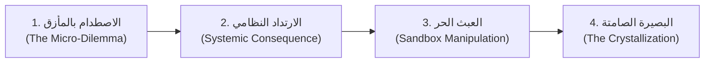

# منصة «الاقتصاد الفطري» (Innate Economics)
### شروحات تفاعلية قابلة للاستكشاف لجوهر الاقتصاد والمال والقرارات الإنسانية
> *مستوحى من النموذج الهندسي والفكري لـ **Explorable Explanations** (على غرار أعمال Bartosz Ciechanowski و Nicky Case) بهوية ولغة عربية فطرية خالية من التلقين الأكاديمي.*

[](https://astro.build)
[](https://react.dev)
[](https://tailwindcss.com)
[](https://vitest.dev)
[](https://www.typescriptlang.org)

---

## 🌟 الرؤية والفلسفة

يهدف هذا المشروع إلى إعادة بناء التعليم الاقتصادي العربي من الجذور؛ فالإنسان بطبعه يتخذ قرارات اقتصادية يومية بفطرته السليمة قبل أن يقرأ سطراً واحداً في النظريات الأكاديمية. 

تعتمد المنصة على مبدأ **«الشروحات القابلة للاستكشاف» (Explorable Explanations)**، حيث لا يتم إملاء المعلومة على القارئ، بل يُوضع أمام مأزق واقعي بموارد محدودة، ليتخذ قراره بيده، ويشاهد العواقب غير المتوقعة لنظامه عبر محاكاة رياضية حية، ثم يتلاعب بالمنزلقات ليكتشف القوانين الطبيعية بنفسه.

---

## 🏛️ دستور التصميم الفطري (قاعدة الحلقات الأربع)

يلتزم كل فصل في المنصة بدورة تصميم صارمة تمنع تحوله إلى "مقال مدرسي جاف":



1. **الاصطدام بالمأزق (The Micro-Dilemma):** يبدأ الفصل بقرار بشري فوري بموارد محدودة وبدون أي مقدمات أو مصطلحات نظرية.
2. **الارتداد النظامي (Systemic Consequence):** يتخذ المستخدم قراره، فيحسب المحرك الرياضي النتيجة ليرى ارتداداً غير متوقع لسلوكه الفردي.
3. **العبث الحر (Sandbox Manipulation):** تُفتح أمام المستخدم المنزلقات والأزرار ليختبر سيناريوهات متعددة ويكتشف حدود النظام وتوازناته بيده.
4. **البصيرة الصامتة (The Crystallization):** تتبلور الحكمة في سطرين بلغة الحياة اليومية، مع شارة هامشية اختيارية توضح المصطلح الأكاديمي المقابل (مثل: "التضخم النقدي"، "تكلفة الفرصة البديلة").

---

## 🗺️ خارطة طريق التجارب الخمس (MVP 100%)

| # | اسم التجربة | المأزق المعاش في التجربة | المفهوم الاقتصادي الكامن | المحرك والواجهة |
| :-: | :--- | :--- | :--- | :--- |
| **1** | **[ميزانية نبضات اليوم](/chapters/1-currency-of-life)** | توزيع 16 ساعة يقظة بين كسب اليوم، صناعة أداة لغدك، وصيانة البدن. | الندرة، تكلفة الفرصة البديلة، تناقص العائد الحدي، وتراكم رأس المال. | محاكاة 7 أيام + منزلق ثلاثي الأبعاد + بصمة قرار قابلة للمشاركة. |
| **2** | **[جزيرة الرغيف والذهب](/chapters/2-bread-and-gold)** | اكتشاف بئر ذهبي في قرية لا ينتج فرنها إلا 20 رغيفاً ومحاولة التسعير الجبري. | التضخم النقدي، حيادية النقود، عواقب التسعير الجبري، وولادة السوق السوداء. | محاكاة طابور المخبز والسوق السوداء بالأزقة ومضاعفة الأفران. |
| **3** | **[لغز المرعى المشترك](/chapters/3-common-pasture)** | 5 رعاة في مرعى يتسع لـ 10 شياه؛ كل راعٍ يربح أكثر كلما زاد غنمه حتى تتصحر الهضبة. | تراجيديا المشاع، العوامل الخارجية السلبية، ميثاق أوستروم، وحقوق الملكية. | هضبة بصرية ديناميكية تتغير خضوبتها ومبدل لأنظمة الحوكمة. |
| **4** | **[استعارة طاقة الغد](/chapters/4-borrowing-tomorrow)** | مزارع يقترض 20 كيساً: هل ينفقها على وليمة زائلة أم يحفر بها بئراً ارتوازياً؟ | الائتمان، الدين الإنتاجي مقابل الاستهلاكي، التفضيل الزمني، والرفع المالي. | تمثيل بصري لحفر البئر وجريان الري ومقارنة مسارات الثروة والإفلاس. |
| **5** | **[همسة في السوق](/chapters/5-whisper-in-the-market)** | صندوق أمانات بنظام احتياطي جزئي، فتنتشر شائعة ويتدافع المودعون في لحظة واحدة. | الاحتياطي الجزئي، الهلع المصرفي (Bank Run)، أزمة السيولة مقابل الملاءة. | تشريح الخزينة (سيولة مقابل قروض)، مشعل الشائعات، وصمامات الأمان. |

---

## 🛠️ المعمارية التقنية وهندسة المشروع

تم تصميم المشروع ليعمل بالكامل في متصفح المستخدم عبر **التوليد الثابت والجزر التفاعلية (Static Site + Interactive Islands)** مع **فصل تام للمحرك الرياضي**:

* **إطار العمل الأساسي:** [Astro 5](https://astro.build) مع تكامل [React 19](https://react.dev) للجزر التفاعلية.
* **طبقة السرد القصصي:** [MDX](https://mdxjs.com) لكتابة القصة التفاعلية المدمجة مباشرة مع مكونات المحاكاة.
* **محرك المحاكاة الرياضي الصرف (`src/engine/`):** كود **TypeScript صارم (Strict Mode)** خالٍ تماماً من أي ارتباط بـ DOM أو React، لضمان أعلى درجات الحتمية وسهولة الاختبار.
* **أنظمة الأنماط:** [Tailwind CSS v4](https://tailwindcss.com) مع دعم أصيل للاتجاه من اليمين لليسار (`dir="rtl"`) وتدرجات لونية معاصرة (Dark Luxury Glassmorphism).
* **الخطوط والطباعة العربية:** *Readex Pro* للعناوين و *IBM Plex Sans Arabic* للنصوص الطويلة.
* **حزم الاختبارات:** [Vitest](https://vitest.dev) للتحقق الصارم من 33 قانوناً رياضياً وبيولوجياً عبر كافة الفصول.

### هيكلة المستودع (Project Tree)

```text
Economics/
├── .github/workflows/
│   └── deploy.yml                   # CI/CD: فحص TypeScript + اختبارات Vitest + بناء Astro
├── specs/                           # المواصفات الفطرية والمعمارية لكل فصل
│   ├── 00-constitution.md           # الدستور الفطري وقواعد التصميم الصارمة
│   ├── 01-time-budget.spec.md       # مواصفات الفصل 1 (الوقت والندرة)
│   ├── 02-bread-and-gold.spec.md     # مواصفات الفصل 2 (التضخم والتسعير)
│   ├── 03-common-pasture.spec.md    # مواصفات الفصل 3 (المشاع والحوكمة)
│   ├── 04-borrowing-tomorrow.spec.md# مواصفات الفصل 4 (الائتمان والاستثمار)
│   └── 05-whisper-in-the-market.spec.md # مواصفات الفصل 5 (السيولة والهلع)
├── src/
│   ├── engine/                      # محركات المحاكاة الصرفة (Pure TypeScript - Zero UI)
│   │   ├── core/                    # دوال رياضية مشتركة (Math utilities, Clamping)
│   │   ├── time-budget/             # محرك ميزانية الوقت ورأس المال
│   │   ├── village-money/           # محرك تداول الذهب والخبز والتسعير
│   │   ├── common-pasture/          # محرك استنزاف وتجدد المرعى
│   │   ├── borrowing-tomorrow/      # محرك الائتمان ومضاعف الري
│   │   └── whisper-market/          # محرك الاحتياطي الجزئي والهلع المصرفي
│   ├── components/
│   │   ├── Header.astro             # شريط الملاحة والهوية الفطرية
│   │   ├── narrative/               # مكونات السرد (DecisionCard, ConsequenceAlert, InsightBox)
│   │   └── simulations/             # الجزر التفاعلية الخمس
│   ├── content/
│   │   └── chapters/                # ملفات الـ MDX التي تمزج القصة بالمحاكاة
│   ├── layouts/
│   │   └── BaseLayout.astro         # القالب الأساسي (RTL, Dark Mode, Fonts, SEO)
│   ├── styles/
│   │   └── global.css               # أنماط Tailwind v4 والزجاجيات والمؤثرات
│   └── pages/
│       ├── index.astro              # الصفحة الرئيسية وفهرس التجارب الـ 5
│       └── chapters/[...slug].astro # صفحات التوليد الثابت للفصول
└── tests/
    └── engine/                      # 33 اختبار Vitest للتحقق من سلامة المنطق الاقتصادي
```

---

## 🚀 التشغيل والتطوير المحلي

### المتطلبات المسبقة:
* [Node.js](https://nodejs.org) (الإصدار 20 أو أحدث).
* مدير الحزم `npm` (أو `pnpm` أو `yarn`).

### خطوات التثبيت والتشغيل:

1. **استنساخ المستودع:**
   ```bash
   git clone https://github.com/your-username/innate-econ.git
   cd innate-econ
   ```

2. **تثبيت الاعتماديات:**
   ```bash
   npm install
   ```

3. **تشغيل حزمة اختبارات المحركات الرياضية (Vitest):**
   ```bash
   npm run test
   ```

4. **تشغيل خادم التطوير المحلي:**
   ```bash
   npm run dev
   ```
   افتح المتصفح على: `http://localhost:4321/`

5. **التحقق من الأنواع وبناء حزمة الإنتاج:**
   ```bash
   npm run typecheck
   npm run build
   ```

---

## 🧪 التحقق من القوانين الرياضية (33 اختباراً)

تم تصميم المحركات لتخضع لحزم اختبار رياضية صارمة قبل عرض أي واجهة بصرية للمستخدم:

* `tests/engine/time-budget.test.ts`: حفظ قيد الـ 16 ساعة، تناقص العائد الحدي، وتضاعف كفاءة الأدوات.
* `tests/engine/village-money.test.ts`: حيادية النقود ($P \propto M$)، أثر الأفران الحقيقية، وظهور السوق السوداء.
* `tests/engine/common-pasture.test.ts`: الطاقة الاستيعابية، تضاؤل وزن الشاة، ميثاق أوستروم، وتسييج الملكيات.
* `tests/engine/borrowing-tomorrow.test.ts`: خدمة الدين، تضاعف حصاد البئر 3 مرات، وحتمية تعثر الدين الاستهلاكي.
* `tests/engine/whisper-market.test.ts`: حفظ الودائع، انهيار السيولة أثناء الركض المصرفي، وصمامات الأمان الطارئة.

---

## 📜 الترخيص والمساهمة

المشروع مفتوح المصدر ومتاح تحت رخصة **MIT**. نرحب بكافة المقترحات والمساهمات لإضافة فصول جديدة أو صقل المحركات الرياضية والسرد القصصي العربي!
